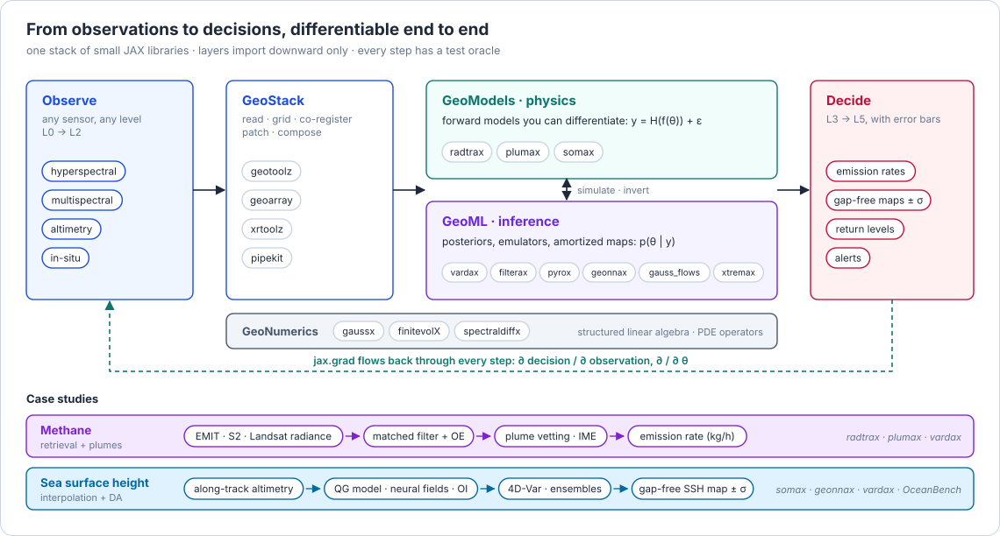
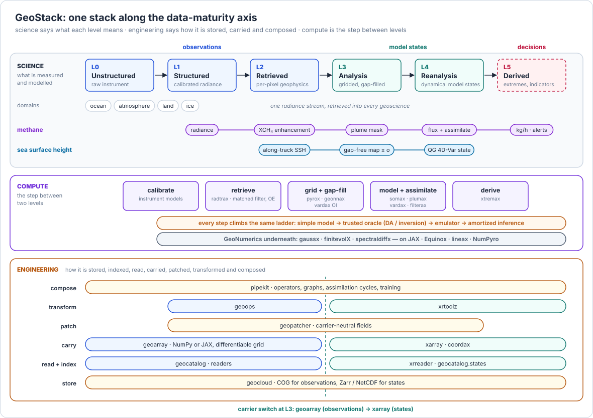
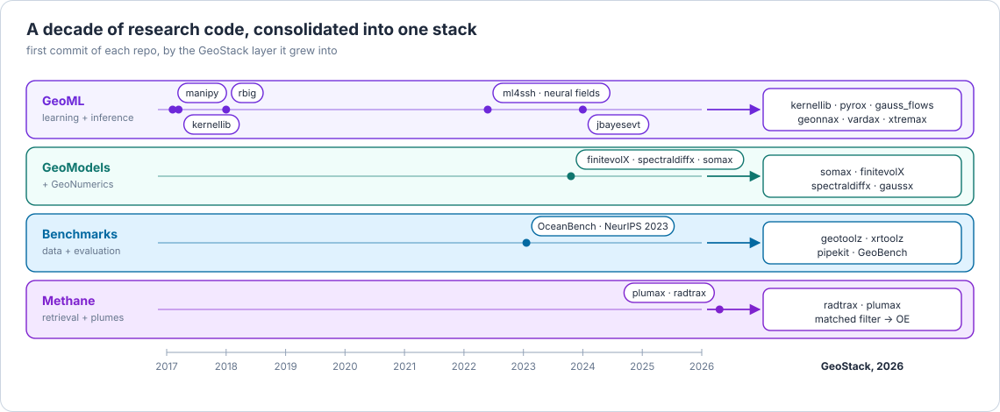

<h2 align="center">J. Emmanuel Johnson</h2>

Research scientist and scientific software engineer · differentiable Earth observation in JAX 
UNEP IMEO · Methane Alert and Response System (MARS) · Valencia, Spain

<a href="https://jejjohnson.github.io/geostack/"><b>GeoStack docs</b></a> ·
<a href="https://jejjohnson.github.io/research_notebook/">Research notebook</a> ·
<a href="https://linkedin.com/in/jejjohnson">LinkedIn</a> ·
<a href="https://twitter.com/jejjohnson">X / Twitter</a>

---

I build the software that turns satellite and in-situ observations into numbers someone can act on, each with an honest error bar.
The physics is differentiable, the inference is Bayesian, and every step is checked against a trusted oracle.
All of it lives in one open-source JAX stack: **GeoStack**.

## The stack

Earth observation code usually means gluing together a reader, a regridder, a physics model, an inverse method and an ML model that were never designed to meet.
GeoStack is the opposite: small libraries with one contract each, laid out along the data-maturity axis from raw instrument output (L0) to decisions (L5).
The **science axis** says what each level means.
The **compute** between two levels is where physics and inference live.
The **engineering axis** underneath says how the data is stored, carried and composed at every level.

<b>How the packages layer</b>: imports only point down, and CI proves the graph has no cycles

| Layer | Library | What it does |
| --- | --- | --- |
| **GeoStack** | [geotoolz](https://github.com/jejjohnson/geotoolz) | Raster operators, STAC catalog and patching; `geoarray`, one geo-carrier for NumPy **and** JAX, with a differentiable affine transform |
| | [xrtoolz](https://github.com/jejjohnson/xrtoolz) | The same operator model on xarray: indices, temporal statistics, CF output |
| | [pipekit](https://github.com/jejjohnson/pipekit) | Composable `Operator` and pipeline protocols shared by every package |
| **GeoNumerics** | [gaussx](https://github.com/jejjohnson/gaussx) | Structured linear algebra: Kalman filters, GP primitives, block operators on lineax |
| | [finitevolX](https://github.com/jejjohnson/finitevolX) | Finite-volume operators on staggered grids |
| | [spectraldiffx](https://github.com/jejjohnson/spectraldiffx) | Spectral derivatives and solvers |
| **GeoML** | [vardax](https://github.com/jejjohnson/vardax) | Variational data assimilation: 3D-Var, 4D-Var, optimal estimation |
| | [filterax](https://github.com/jejjohnson/filterax) | Ensemble and Kalman filtering |
| | [pyrox](https://github.com/jejjohnson/pyrox) · [kernellib](https://github.com/jejjohnson/kernellib) | Gaussian processes and probabilistic NNs for NumPyro; kernels |
| | [geonnax](https://github.com/jejjohnson/geonnax) | Neural fields and basis functions for geoscience |
| | [gauss_flows](https://github.com/jejjohnson/gauss_flows) | Normalizing flows and SurVAE |
| | [optax_bayes](https://github.com/jejjohnson/optax_bayes) | The Bayesian learning rule as Optax optimizers |
| | [xtremax](https://github.com/jejjohnson/xtremax) | Extreme values with JAX and NumPyro |
| **GeoModels** | [radtrax](https://github.com/jejjohnson/radtrax) | Differentiable radiative transfer, matched filters, retrievals |
| | [plumax](https://github.com/jejjohnson/plumax) | Plume physics: masks, integrated mass enhancement, flux, emission rates |
| | [somax](https://github.com/jejjohnson/somax) | Simple ocean models: quasi-geostrophic, shallow water |

## The method

Every problem in the stack follows the same ladder.
Step 2, a slow but trusted physics-based inversion, is the oracle that every faster learned method must match before it ships.

## Case studies

### Methane: from radiance to emission rate

Detecting and quantifying methane plumes from EMIT, Sentinel-2 and Landsat 8/9.
A layered Beer–Lambert forward model in [radtrax](https://github.com/jejjohnson/radtrax) gives the matched-filter target and every Jacobian by autodiff.
The pipeline then runs matched filter, plume vetting and optimal estimation through [vardax](https://github.com/jejjohnson/vardax).
[plumax](https://github.com/jejjohnson/plumax) turns the column enhancement into an emission rate in kg/h.

<b>The full methane walkthrough</b>, from scene catalog to served model

### Sea surface height: from altimetry tracks to gap-free maps

Mapping the ocean's mesoscale from sparse along-track altimetry.
**[OceanBench: The Sea Surface Height Edition](https://arxiv.org/abs/2309.15599)** (NeurIPS 2023, Datasets and Benchmarks) is a benchmark and toolkit for SSH interpolation ([docs](https://jejjohnson.github.io/oceanbench), [code](https://github.com/jejjohnson/oceanbench)).
The methods range from optimal interpolation and neural fields ([ml4ssh](https://github.com/jejjohnson/ml4ssh), [knerf](https://github.com/jejjohnson/knerf), [functa4eo](https://github.com/jejjohnson/functa4eo)) to quasi-geostrophic models in [somax](https://github.com/jejjohnson/somax) inside 4D-Var.

## How it came together

GeoStack is not a fresh start; it is ten years of research code, rebuilt so the pieces fit.

Older work still worth a look: [rbig](https://github.com/jejjohnson/rbig) (Rotation-Based Iterative Gaussianization and information measures), [jbayesevt](https://github.com/jejjohnson/jbayesevt) (Bayesian extreme value models), [manipy](https://github.com/jejjohnson/manipy) (semi-supervised manifold learning), [keras-fairkl](https://github.com/jejjohnson/keras-fairkl) (fair kernel learning), and my [research notebook](https://jejjohnson.github.io/research_notebook/) of notes and tutorials.

## How I work

- **JAX all the way down.** Equinox modules, with `jit`, `vmap` and `grad` through the physics, and float64 where the maths needs it.
- **Tested against the truth.** Every refactor merges behind numeric gates: parity with the code it replaces, autodiff against finite differences, closed-form oracles.
- **Small packages, explicit seams.** Heavy dependencies sit behind optional extras, and everything is MIT-licensed.

**Interests:** atmospheric retrievals · data assimilation · Gaussian processes and uncertainty quantification · neural fields · extremes · ML for dynamical systems.

Figures generated with GeoStack's own figure code · Python · JAX · Equinox · NumPyro · xarray

